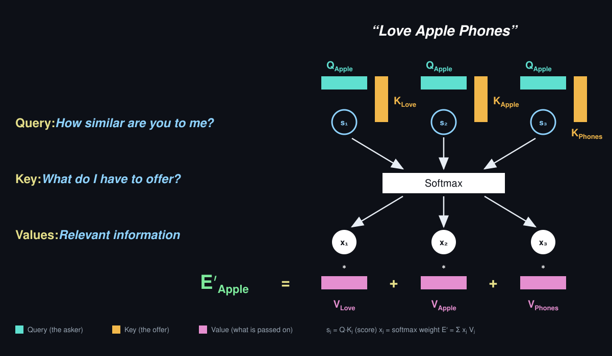

# Training Plan: Attention — Query, Key and Value (Socratic)
Generated: 2026-11-13 | Status: in-progress | Target level: Master's

## Learning Goal
Attention mechanism: Key, Query and Value. Use one graphical representation along the whole course (the "Love Apple Phones" diagram). Show what value the differentiation of Query and Key brings.

## SMART Goal
Derive scaled dot-product attention on one diagram and prove what separating Query from Key buys.

## Course Diagram (used in every session)



Every session of this course is run on this one picture and this one sentence. Nothing else is drawn.

```
                      "Love Apple Phones"

   Q_Apple · K_Love     Q_Apple · K_Apple     Q_Apple · K_Phones
        (s1)                 (s2)                  (s3)          scores
          \                   |                    /
           +------------- Softmax ---------------+
          /                   |                    \
        (x1)                 (x2)                  (x3)          weights
         *                    *                     *
 E'_Apple =  V_Love      +   V_Apple       +     V_Phones        values
```

| Symbol in the picture | Role | Caption in the picture |
|-----------------------|------|------------------------|
| Q_Apple (row vector, teal) | The asker: the token being rewritten | "How similar are you to me?" |
| K_Love, K_Apple, K_Phones (column vectors, amber) | The offers: one per token of the sentence | "What do I have to offer?" |
| s1, s2, s3 (open circles) | Scores: one number per query-key pair | — |
| x1, x2, x3 (white circles) | Weights after the Softmax | — |
| V_Love, V_Apple, V_Phones (pink) | What each token passes on | "Relevant information" |
| E'_Apple (green) | The rewritten embedding of Apple | — |

Token order is fixed: 1 = Love, 2 = Apple, 3 = Phones. Each blueprint has a **Diagram focus** line naming the part of the picture that session works on.

## Pedagogical Method: Socratic Discovery

Each session follows a **Question → Tension → Resolution → Test** arc:

1. **Discovery Question** — a scenario that creates genuine puzzlement. The learner must *feel* the gap before any concept is introduced.
2. **Tension** — the learner's natural first attempt fails or is incomplete. This is designed, not accidental.
3. **Resolution** — the concept emerges as the *only* way to resolve the tension. It is not presented as a fact to memorize but as an inevitability.
4. **Test** — the learner demonstrates they can reconstruct the reasoning, not just repeat the answer.

**Socratic Guidance Chains** are provided in each blueprint: sequences of 3-6 questions the instructor asks if the learner is stuck. Each question narrows the search space without giving the answer. The chain is designed so that answering the last question makes the conclusion inescapable.

**The arc is a form of Test-Teach-Test.** Attempt each test cold, before reading its blueprint:

| Test-Teach-Test | In this plan |
|-----------------|--------------|
| Test | Discovery Question and Initial Test: the first attempt meets the **tension** |
| Teach | Socratic Guidance Chain: the **resolution** is derived through questions, not explained |
| Test | Final Test, including its "reconstruct the reasoning" part |

## Motivation & Course Overview (VOC)
> _Editable by the learner. This is the course's bird's-eye view and
> voice-of-customer anchor. If you change anything here, tell me — your
> feedback may restructure the plan (re-decomposition of sub-goals)._

**Why this matters:** Attention is the operation every Transformer, and so every current language model, repeats in each layer. People who can recite "query, key, value" but cannot say why there are three vectors and not one cannot read an attention map, debug a head, or judge a proposal to simplify the architecture.

**Bird's-eye view of the course:** The whole course stays on one picture: the token Apple in "Love Apple Phones" being rewritten from its neighbours. It starts from why Apple needs its neighbours at all, then builds the picture from the bottom up (the mix of values), through the middle (scores and Softmax), to the top (the query and the keys). The centre of the course is the question the picture raises by itself: why is the vector that asks different from the vector that offers? The last sessions turn that answer into matrices, into a measurable quantity, into code and into a design decision the learner defends.

**Core principles & key facts:** (1) A token's new embedding is a weighted mix of what every token passes on. (2) The weights come from a match score between one asker and each offer, turned into positive shares that sum to one. (3) Asking and offering are two different learned views of the same token. (4) What decides how much a token counts is separate from what it contributes. The facts the course leans on: the score is divided by the square root of the key dimension, the Softmax runs over the keys of one query, Q and K must have the same length while V need not, and the reference sizes of the original Transformer.

**What you'll be able to do on completion:**
- Compute E'_Apple by hand from Q, K and V, and explain every box and arrow of the picture
- Write the whole picture as one matrix formula and read off any row of it
- Prove what a head with a single shared vector for asking and offering cannot do, and show a head with separate Q and K doing it
- Split a head's scoring into the part a shared vector could reproduce and the part that needs the Q/K differentiation
- Say what the value vector adds that the key cannot
- Implement the picture, tie Q to K in code, and defend or reject that simplification with evidence

## Breakthrough
> _The story behind the topic: what the situation was before the key
> intuition, and what the topic solved._

**Before the intuition:** Sequence models read a sentence one word at a time and carried everything seen so far in one running summary of fixed size. Long sentences overflowed it: by the end, the early words were blurred, and translation quality fell with sentence length.

**The intuition:** Do not compress the sentence; keep every word and let each position look back and take what it needs, in proportion to how relevant each word is. This was introduced for translation by Bahdanau, Cho and Bengio (2014), and made the sole mechanism of the Transformer by Vaswani and colleagues (2017).

**What it solved:** Any word can draw on any other in one step, whatever the distance, and all positions can be computed in parallel. That is what made training on very large text collections practical.

| Principle | Before the intuition | What it solved |
|-----------|----------------------|----------------|
| Weighted mixing | A word had one fixed vector, or a summary that every later word had to share. Context was either absent or the same for everyone. | Each word gets its own blend of the sentence, so the same word can mean different things in different sentences. |
| Scoring by match | Which earlier words mattered was fixed by position or by a small separate network that was slow to evaluate for every pair. | Relevance is computed from content with one cheap operation per pair, for all pairs at once. |
| Query-Key differentiation | Early attention scored each pair of words with a small separate network. When that was replaced by a plain product of two vectors, which two vectors to multiply had to be settled. | A score as cheap as one product per pair that kept the freedom to learn which word reads which. |
| Value decoupling | What a word contributed was the same vector that was used to find it. | Being found and being useful became two separately learned things. |

## Principle Extraction

| Principle | Statement | Formally | Prerequisites |
|-----------|-----------|---------|---------------|
| Weighted mixing | The new embedding of a token is a weighted average of the value vectors of all tokens, with positive weights that sum to one. | $E'_i = \sum_j x_{ij} V_j,\quad x_{ij} > 0,\ \sum_j x_{ij} = 1$ | Vectors, linear combinations, word embeddings |
| Scoring by match | Each weight comes from the dot product of one query with one key, normalised across the keys by a Softmax. | $x_{ij} = \dfrac{e^{s_{ij}}}{\sum_{l} e^{s_{il}}},\quad s_{ij} = \dfrac{Q_i \cdot K_j}{\sqrt{d_k}}$ | Dot product, exponential function |
| Query-Key differentiation | Query and key are two separate learned projections of the same embedding, so the score from i to j is not tied to the score from j to i nor to how well a token matches itself. | $Q_i = e_i W_Q,\ K_j = e_j W_K,\quad s_{ij} \propto e_i\, W_Q W_K^{\top} e_j^{\top}$ | Matrix multiplication, transpose, symmetric and positive semidefinite matrices, Cauchy-Schwarz inequality |
| Value decoupling | The vector that decides how much a token counts (its key) is separate from the vector it contributes (its value). | $V_j = e_j W_V$, with $W_V$ independent of $W_Q$, $W_K$ | Linear maps |

## Hard Core
> _The principles that are hardest to grasp. Each is taught through an aha
> moment and a climb through the levels, with a solved exercise at every rung.
> If this list looks wrong to you, tell me which principle to add or remove._

| Principle | Why it is hard | Taught in |
|-----------|----------------|-----------|
| Query-Key differentiation | counter-intuitive, persistent misconception, load-bearing (4 sub-goals depend on it) | SG-4 |

## Key Facts
> _What this course relies on you simply knowing. Values marked `(verify)`
> should be checked against a source before you rely on them._

| # | Key Fact | Why it matters | Used in |
|---|----------|----------------|---------|
| KF-1 | In scaled dot-product attention the score is divided by $\sqrt{d_k}$, where $d_k$ is the length of the query and key vectors. | Without it, computed weights do not match those of any real implementation. | SG-6, SG-7, SG-10, SG-11 |
| KF-2 | The Softmax is applied across the keys of one query: each query's weights sum to 1 (in matrix form, each row). | Normalising in the other direction gives numbers that look like weights and are not. | SG-3, SG-7, SG-10, SG-11 |
| KF-3 | In self-attention Q, K and V are three linear projections ($W_Q$, $W_K$, $W_V$) of the same input embeddings. Q and K must have the same length $d_k$; V may have another length $d_v$. | Shapes cannot be checked, and a head cannot be read, without it. | SG-4, SG-5, SG-7, SG-8, SG-9, SG-10 |
| KF-4 | The original Transformer (Vaswani et al., 2017) uses $d_{model} = 512$, 8 heads, $d_k = d_v = 64$. | Gives the realistic sizes for the scaling and parameter-count cases. | SG-6, SG-8 |
| KF-5 | Diagram convention of this course: tokens are ordered Love, Apple, Phones (1, 2, 3); in any score table the row is the asking token (query) and the column the offering token (key). | Reading a table transposed reverses who attends to whom. | SG-3 to SG-11 |
| KF-6 | $e^{1} \approx 2.718$, $e^{2} \approx 7.389$, $e^{3} \approx 20.086$, $e^{4} \approx 54.598$, $e^{6} \approx 403.43$, $e^{8} \approx 2981.0$, $e^{16} \approx 8.886 \times 10^{6}$, $e^{-1} \approx 0.368$, $e^{0.5} \approx 1.649$, $e^{0.25} \approx 1.284$, $e^{0.125} \approx 1.133$. | The hand calculations use them. | SG-3, SG-5, SG-6, SG-7, SG-10, SG-11 |

## Sub-Goals

| # | Axis | Sub-Goal | Domain | Difficulty | Depth | Principle | Status | Score |
|---|------|----------|--------|-----------|-------|-----------|--------|-------|
| SG-1 | Motivation | Discover from history why one fixed vector per word fails and what replaces it | Contextual representation | low | MSc | — | pending | - |
| SG-2 | Core Principle | Discover why E'_Apple must be a weighted average of the three value vectors | Attention output | low | MSc | Weighted mixing | pending | - |
| SG-3 | Core Principle | Discover how Q_Apple and three keys become three weights that sum to one | Attention scoring | low | MSc | Scoring by match | pending | - |
| SG-4 | Core Principle | Discover what a head loses when one vector both asks and offers | Q/K differentiation | low | MSc | Query-Key differentiation | pending | - |
| SG-5 | Core Principle | Discover why what Apple receives from a token is separate from its key | Value projection | low | MSc | Value decoupling | pending | - |
| SG-6 | Key Concept | Discover why the three scores are divided by the square root of d_k | Scaling | high | MSc | Scoring by match | pending | - |
| SG-7 | Key Concept | Discover the single matrix formula of which the diagram is one row | Matrix form | medium | MSc | Weighted mixing, Scoring by match | pending | - |
| SG-8 | Key Concept | Discover that only the product of the Q and K projections is ever observed | Bilinear score | high | MSc | Query-Key differentiation | pending | - |
| SG-9 | Key Concept | Discover how to measure which part of a head's scoring needs separate Q and K | Score decomposition | high | MSc | Query-Key differentiation | pending | - |
| SG-10 | Tools | Discover, by coding the diagram and tying K to Q, what the ablation changes | Implementation | medium | MSc | Scoring by match, Query-Key differentiation, Value decoupling | pending | - |
| SG-11 | Verification | Discover whether you can compute the diagram unaided and defend its three-vector design | Integration | high | MSc | All four | pending | - |

_Depth is the plan's Target level in every row: HS = High school, MSc = Master's, Adv = Advanced._
_Difficulty is derived: low = 1 principle; medium = 2-3 principles; high = 4+ principles, or a proof or derivation required. Core Principle sub-goals are low by rule; SG-1 has no principle (low). SG-7 and SG-10 combine 2 and 3 principles (medium). SG-6 (the variance derivation of √d_k), SG-8 (the invariance proof) and SG-9 (the definiteness proof) are high by the derivation clause; SG-11 is high by the 4+ clause._

## Prerequisite Graph

```
Derive attention on one diagram and prove what the Q/K split buys (core)
  requires:
    Vectors, dot product, matrix product and transpose (prerequisite) ← CHECK learner profile
    Exponential function and normalisation to shares (prerequisite) ← CHECK learner profile
    Word embeddings as learned vectors (prerequisite) ← CHECK learner profile
    Variance of a sum of independent terms (prerequisite, SG-6 only) ← CHECK learner profile
    Symmetric and positive semidefinite matrices, Cauchy-Schwarz (prerequisite, SG-4, SG-9) ← CHECK learner profile
    Reading NumPy array code (prerequisite, SG-10 only) ← CHECK learner profile
  rests on:
    Weighted mixing (principle) → SG-2
      led to:
        Scoring by match (principle) → SG-3
          led to:
            Scaling (concept) → SG-6
              led to:
                Matrix form (concept, also uses Weighted mixing) → SG-7
            Query-Key differentiation (principle) → SG-4
              led to:
                Bilinear score (concept) → SG-8
                  led to:
                    Score decomposition (concept) → SG-9
        Value decoupling (principle) → SG-5
    All four principles and SG-7
      led to:
        Implementation (tools) → SG-10
          led to:
            Integration (verification) → SG-11
```

**WARNING:** no learner profile exists yet, so none of the six external prerequisites is confirmed. If linear algebra with positive semidefinite matrices is rusty, say so before SG-4: the session will open with a short check.

## Sequence
- SG-1 first: it creates the need for the picture.
- SG-2 before SG-3: the weights have to be wanted (bottom of the picture) before asking where they come from (middle).
- SG-3 before SG-4: the score must exist before asking why its two inputs differ (top of the picture).
- SG-5 after SG-2: it needs the mix. Placing it after SG-4 is an ordering preference, not a graph dependency: the three roles are then separated in the order of the picture.
- SG-6 after SG-3; SG-7 after SG-6 (graph edge Scaling → Matrix form: the matrix formula includes the scaling).
- SG-8 after SG-4, SG-9 after SG-8: SG-9 decomposes the matrix that SG-8 identifies.
- SG-10 after SG-7 and SG-5 (it codes the matrix form with values) and after SG-4 (it ablates the Q/K split).
- SG-11 last.

Suggested order: SG-1, SG-2, SG-3, SG-4, SG-5, SG-6, SG-7, SG-8, SG-9, SG-10, SG-11.

## Session Blueprints
> _Session designs. Run a sub-goal's session before reading its blueprint: the
> questions and tests work best unseen. The solved exercises are there to study afterwards._

### SG-1: Why Apple needs its neighbours
- **Context:** *Why it matters:* every language model repeats one operation in every layer, and the course picture is that operation; this session shows what problem it was built to solve. *Historical context:* in 2013 word-embedding methods such as word2vec gave every word of the vocabulary a learned vector, and these vectors became the standard input of language models. In 2014 encoder-decoder translation models read a source sentence word by word and handed the decoder one summary vector of fixed size; they translated short sentences well, and their quality dropped on long ones. Later in 2014 Bahdanau, Cho and Bengio changed how the decoder reads the source sentence, and in 2017 the Transformer built a whole model around that change.
- **Diagram focus:** only the sentence title and E'_Apple. The rest of the picture is covered: the session asks what would have to be in the covered area. Page objects for the teaching stage only (after the Initial Test is answered): a lookup-table widget that shows Apple's table vector beside "Love Apple Phones" and "Love Apple Pie" (before/after a switch of sentence), and a fixed-window widget with weights (0.25, 0.5, 0.25) that slides over a sentence whose word order can be changed.
- **Discovery Question:** In 2013 a lookup table gave the word Apple one vector. In "Love Apple Phones" a reader knows at once that Apple is a company, and in "Love Apple Pie" that it is a fruit. Is that difference anywhere in the table's vector for Apple? Answer yes or no, with one sentence of reason.
- **Initial Test:** Three questions, each with a stated form of answer. (a) A lookup table holds one vector per word. The sentence changes from "Love Apple Phones" to "Love Apple Pie". Does the vector of Apple change? (yes or no, one sentence why.) (b) A 2014 encoder-decoder model compresses any sentence into one summary vector of 4 numbers (a toy size: real models of 2014 used about a thousand; the toy keeps the arithmetic small). How many numbers per word does the summary have for a 4-word sentence and for a 40-word sentence? (two numbers.) (c) To make Apple mean the company in "Love Apple Phones", its vector should take something from its neighbours. Name two requirements on the amounts taken from Love and from Phones (for example, what they must or must not depend on). (two short phrases.) *Designed wrong path: in (c), amounts fixed in advance or set by distance in the sentence.*
- **Pass Criteria:** (a) no: the table has one vector per word whatever the sentence; (b) 1 and 0.1; (c) at least two of: they depend on what the words are (content); they do not depend on position alone; they are computed for each word separately; they work for any sentence length; they are learned.
- **Estimated Depth:** Master's
- **Principle:** —
- **Socratic Guidance Chain (if stuck):**
  1. Switch the sentence from "Love Apple Phones" to "Love Apple Pie". What happens to the table's vector for Apple?
  2. A summary of fixed size must hold a 4-word sentence and a 40-word one. What happens to the room each word gets?
  3. Keep every word's vector instead, and let Apple take a blend of them. Which word should have the largest share for Apple to mean the company?
  4. The same words are typed in another order. Should the share of Phones for Apple change?
  5. Should Love be rewritten with the same shares as Apple, or with its own?
- **Anticipated CTQs:**
  | CTQ | Source | Mastery Test | Common Failure Mode |
  |-----|--------|-------------|---------------------|
  | A static embedding cannot carry context: one vector per word whatever the sentence | Contextual representation | Predict what changes in the table's vector when the sentence changes | overgeneralization: "the embedding knows the meaning" |
  | A fixed-size summary thins out as the sentence grows | Contextual representation | Compute the room per word for two sentence lengths | verbal-without-formal: "long sentences are hard" with no mechanism |
  | The shares must depend on content and be computed per word | Contextual representation | Predict the effect of reordering the sentence, and of sharing one set of shares | conflation: relevance confused with proximity |
- **Teach Topics:** static embeddings (2013) and what they cannot do; the fixed-size summary of encoder-decoder models (2014) and why it fails on long sentences; keeping every word's vector and blending by shares (2014 onward); the four requirements on the shares as the specification of the covered area of the picture. [overgeneralization]: "the embedding knows the meaning". [conflation]: nearby and relevant. Socratic note: do not name query, key or value in this session; ask only "what would have to be computed here?"
- **Final Test:** A fixed window is a real alternative: each word is rewritten from its neighbours with weights fixed by position, as a convolution filter does. Take the weights 0.25 for the left neighbour, 0.5 for the word itself, 0.25 for the right neighbour. (a) Give the share of Phones when rewriting Apple in "Love Apple Phones" and in "Apple Love Phones". (two numbers.) (b) Say why this result is not acceptable for a reader who wants Apple to mean the company in both sentences. (one or two sentences.) (c) *Reconstruct the reasoning:* the lookup table and the fixed window each lack something that the shares of attention must have. Name what each one lacks. (two short phrases.)

### SG-2: The mix at the bottom of the picture
- **Context:** *Why it matters:* the bottom row of the picture is where a word's new meaning is assembled; every later session only explains where its three weights come from. *Historical context:* once translation models kept every word's vector instead of one summary (2014), the decoder had several vectors in front of it where it used to have one, and it still had to be handed a single input at each step. How to build that input from several vectors was the first design decision of attention.
- **Diagram focus:** bottom row only: x1, x2, x3, the three pink value boxes and E'_Apple. The weights are given; where they come from is covered.
- **Principle:** Weighted mixing — The new embedding of a token is a weighted average of the value vectors of all tokens, with positive weights that sum to one.
- **Worked Example (foundational):**
  **Given:** weights x = (0.2, 0.3, 0.5); V_Love = (4, 0), V_Apple = (0, 2), V_Phones = (2, 6).
  **Step 1:** Scale each value by its weight: 0.2·(4, 0) = (0.8, 0); 0.3·(0, 2) = (0, 0.6); 0.5·(2, 6) = (1, 3).
  > **Why:** "Why multiply and not pick the largest?" Because every token keeps a say in proportion to its weight; picking would throw away the other two.
  **Step 2:** Add: E'_Apple = (0.8 + 0 + 1, 0 + 0.6 + 3) = (1.8, 3.6).
  > **Why:** "Why add?" Because the result has to be one vector of the same kind as the values, so that the next layer can use it.
  **Step 3:** Compare with the values: each coordinate of E'_Apple lies between the smallest and largest of that coordinate among the values (0 ≤ 1.8 ≤ 4 and 0 ≤ 3.6 ≤ 6).
  > **Why:** "Could it land anywhere?" No: weights that are positive and sum to one keep the result inside the triangle whose corners are the three values.
  **Result:** E'_Apple = (1.8, 3.6): a point inside the triangle of the three values, pulled towards the corner with the largest weight.
  > **Check:** Start at V_Love and move part of the way to the others: (4, 0) + 0.3·(−4, 2) + 0.5·(−2, 6) = (4 − 1.2 − 1, 0 + 0.6 + 3) = (1.8, 3.6). Same point.
- **Discovery Question:** The picture ends in a sum of three weighted vectors. If the purpose is to make Apple "more phone-like", why does the picture not simply hand V_Phones to Apple?
- **Initial Test:** V_Love = (0, 4), V_Apple = (4, 0), V_Phones = (4, 4). Four results are claimed for E'_Apple: A = (4, 4), B = (3, 3), C = (5, 3), D = (1, 1). The weights come out of a Softmax fed with finite scores. (a) For each of A, B, C and D, say whether the bottom of the picture can produce it exactly. (yes or no for each, with one sentence why.) (b) For each one you answered yes, give the weights. (three numbers that sum to 1.) *Designed wrong path: treat the weights as free numbers, or treat attention as picking one token.*
- **Pass Criteria:** Can state the principle in own words AND apply it (B with weights (0.25, 0.25, 0.5); C and D impossible; A not reachable with finite scores, only approached) AND explain why the alternative fails (free or negative weights would allow C; picking would allow A exactly).
- **Estimated Depth:** Master's
- **Socratic Guidance Chain (if stuck):**
  1. What two conditions do the three weights satisfy, whatever the scores are?
  2. With those conditions, what is the largest first coordinate E'_Apple can have here?
  3. For D = (1, 1): the first coordinate fixes x2 + x3. What does that leave for x1, and is the second coordinate then possible?
  4. Can a Softmax output be exactly zero for a finite score? What does that say about A?
  5. So what is the set of all results the bottom of the picture can produce?
- **Anticipated CTQs:**
  | CTQ | Source | Mastery Test | Common Failure Mode |
  |-----|--------|-------------|---------------------|
  | The output is a convex combination: it stays inside the hull of the values | Weighted mixing | Given three values and a target, decide reachability and recover the weights | procedural-without-conceptual: computes the sum but cannot say what is impossible |
  | Attention blends; it never selects exactly | Weighted mixing | Explain why E' = V_Phones exactly cannot occur | conflation: soft weighting confused with lookup |
- **Teach Topics:** convex combination; the triangle of values; soft versus hard selection; why the output has the dimension of the values. [conflation]: "the model looks at Phones" read as "the model copies Phones". Socratic note: ask "where can the green vector not be?" before asking where it is.
- **Final Test:** V_Love = (2, 2), V_Apple = (8, 2), V_Phones = (2, 8). (a) Find the weights that give E'_Apple = (5, 3.5). (three numbers.) (b) Show that (9, 2) cannot be produced. (a one- or two-sentence argument.) (c) *Reconstruct the reasoning:* a colleague says "if Phones is the relevant token, the best head sets E'_Apple = V_Phones". Explain from the two properties of the weights why this cannot happen. (two to four sentences.) (d) Say what would be lost about Apple itself if it could. (one sentence.)

### SG-3: From one query and three keys to three weights
- **Context:** *Why it matters:* the three weights decide which words Apple listens to; this session shows how three vectors become three weights. *Historical context:* the first attention model (2014) scored each pair of words with a small neural network. In 2015 Luong and colleagues showed that a plain dot product also works, and the Transformer (2017) adopted it because it is cheap and can be computed for all pairs at once. Scores made this way can be any real numbers, positive, zero or negative, while the bottom of the picture (SG-2) needs shares.
- **Diagram focus:** top and middle: Q_Apple paired with K_Love, K_Apple, K_Phones, the three open circles s1, s2, s3, the Softmax box and x1, x2, x3. The values are covered.
- **Principle:** Scoring by match — Each weight comes from the dot product of one query with one key, normalised across the keys by a Softmax.
- **Worked Example (foundational):**
  **Given:** Q_Apple = (2, 1); K_Love = (0, 0), K_Apple = (0, 1), K_Phones = (1, 0). Scaling is left out here; it is the subject of SG-6.
  **Step 1:** One dot product per pair: s1 = 2·0 + 1·0 = 0; s2 = 2·0 + 1·1 = 1; s3 = 2·1 + 1·0 = 2.
  > **Why:** "Why a dot product?" It is the cheapest single number that is large when two vectors point the same way and that can be computed for all pairs at once.
  **Step 2:** Exponentiate: e^0 = 1, e^1 = 2.718, e^2 = 7.389. Sum = 11.107.
  > **Why:** "Why the exponential?" Scores can be negative; the exponential makes every one of them positive while keeping their order.
  **Step 3:** Divide by the sum: x = (1, 2.718, 7.389) / 11.107 = (0.090, 0.245, 0.665).
  > **Why:** "Why divide?" So that the three numbers are shares of one whole, as SG-2 requires.
  **Result:** x = (0.090, 0.245, 0.665). Phones gets about two thirds of Apple's attention.
  > **Check:** The shares sum to 1.000. A score gap of 1 must give a ratio of e: 0.665 / 0.245 = 2.71 and 0.245 / 0.090 = 2.72.
- **Discovery Question:** Three match scores come out of the circles: 2, −1 and 2. SG-2 needs three positive shares that sum to one. What do you do to the scores?
- **Initial Test:** Q_Apple = (1, −1); K_Love = (2, 0), K_Apple = (0, 1), K_Phones = (3, 1). Scores are unscaled, as in the worked example (no division by √d_k). (a) Compute s1, s2, s3. (three numbers.) (b) Turn them into weights. (three numbers to 3 decimals.) (c) Someone adds 10 to all three scores: what happens to the weights? (a short phrase.) *Designed wrong path: divide each score by the sum of the scores, which gives (2/3, −1/3, 2/3).*
- **Pass Criteria:** Can state the principle in own words AND apply it (scores (2, −1, 2); weights (0.488, 0.024, 0.488); unchanged under the shift) AND explain why dividing by the sum fails (negative share; breaks down when the sum is zero).
- **Estimated Depth:** Master's
- **Socratic Guidance Chain (if stuck):**
  1. What does dividing by the plain sum give for the score −1? Is that a share?
  2. What would it give if the scores were 1, −1 and 0?
  3. Which function turns any real number into a positive one without changing the order?
  4. After applying it, what single operation makes the three results sum to one?
  5. If every score grows by the same constant, by what factor does each exponential grow, and what does the division do to that factor?
- **Anticipated CTQs:**
  | CTQ | Source | Mastery Test | Common Failure Mode |
  |-----|--------|-------------|---------------------|
  | The Softmax is the normalisation that survives negative scores and keeps order | Scoring by match | Compute weights from scores with mixed signs and justify each step | procedural-without-conceptual: applies the formula, cannot say why not a plain ratio |
  | Only score differences matter | Scoring by match | Predict the effect of shifting all scores, and of doubling them | formal-without-intuitive: can prove the shift invariance, cannot predict the doubling |
- **Teach Topics:** dot product as match; Softmax; shift invariance; sharpening when scores are multiplied. [conflation]: score and weight. [overgeneralization]: "the largest score always takes almost everything". Socratic note: let the learner hit the negative share before the word Softmax is used.
- **Final Test:** Q_Apple = (0, 2); K_Love = (1, 1), K_Apple = (3, 0), K_Phones = (−1, 1.5). Scores are unscaled, as in the worked example. (a) Compute the three weights. (three numbers to 3 decimals.) (b) All three keys are doubled: compute the new weights. (three numbers to 3 decimals.) (c) Explain from the formula why doubling the keys moved weight towards Phones although the order of the scores did not change. (two or three sentences.) (d) *Reconstruct the reasoning:* explain why the picture has the Softmax box and not a "divide by the total" box. (three to five sentences.)

### SG-4: Why the asker and the offer are different vectors
- **Context:** *Why it matters:* this is the centre of the course: why the picture draws the asking vector and the offering vector as two different things. *Historical context:* in the 2014 attention model the asker was a decoder state and the offers were encoder states, two different objects by construction. Models in which a sentence attends to its own words followed (for example Cheng, Dong and Lapata, 2016; Lin and colleagues, 2017), and in the Transformer (2017) every word of a sentence both asks and is asked, so the asker and the offers come from the same words. The Transformer nevertheless gives each word two separately learned projections for the two roles, named query and key.
- **Diagram focus:** the top row: the teal Q_Apple against the three amber keys, in particular the middle pair Q_Apple with K_Apple, where the same token appears in both roles.
- **Principle:** Query-Key differentiation — Query and key are two separate learned projections of the same embedding, so the score from i to j is not tied to the score from j to i nor to how well a token matches itself.
- **Tempting answer:** "One vector per token is enough. The picture's own caption says the query asks *how similar are you to me?*; similarity is measured between two vectors of the same kind, so let each token's key be its query. Tokens that should attend to each other are simply given similar vectors." It feels right because resemblance is how embeddings are usually explained, and because the saving looks free.
- **Insight:** Asking and offering are two different jobs: the score Apple gives Phones should neither fix the score Phones gives Apple nor be capped by how well each token scores itself; one vector per token ties them together (equal mirror scores; a cross score never above the geometric mean of the two self scores), so one vector cannot do both jobs.
- **Picture:** A classifieds board. Every token posts two cards: a "wanted" card (query) and an "on offer" card (key). A match is read from one token's wanted card against another's offer card. With a single card per token, the only possible question is "who resembles me?", and two tokens can never match each other better than the geometric mean of their two self-matches: nobody can out-match both your own self-match and theirs. Where it stops being true: real cards are written by their owner for a purpose; here both cards are produced by learned matrices, and only their pairing is ever used (SG-8).
- **Visual design:**
  - **Objects:** the course diagram's top row for the asker Apple, and beside it a 3×3 score grid (rows = asker, columns = offer, order Love, Apple, Phones). Shared vectors: Love (1, 0), Apple (1, 1), Phones (0, 2), giving the grid [[1, 1, 0], [1, 2, 2], [0, 2, 4]]. Separate vectors: queries as above, keys K_Love = (0, 1), K_Apple = (1, 0), K_Phones = (2, 0), giving [[0, 1, 2], [1, 1, 2], [2, 0, 0]].
  - **Colour roles:** teal = query (asker), amber = key (offer), pink = value (shown greyed, not used in this session).
  - **Steps:** (1) the three shared vectors appear, each drawn once in a neutral colour; (2) the grid fills from them, and the cell Apple→Phones and its mirror Phones→Apple light together; (3) the diagonal lights; (4) each vector splits into a teal and an amber copy, and the amber copies move to the key values; (5) the grid is recomputed and the two mirror cells now show different numbers.
  - **Your-turn inputs** (new cases, used nowhere else in the plan): *High school rung:* "Shared vectors Love (2, 3) and Phones (4, 1). The score Phones→Love is…" right 11 (= 4·2 + 1·3, the same number as Love→Phones); wrong 17 (computed Phones with itself: reads the grid along the diagonal instead of the mirror cell); wrong 14 (= 2·1 + 3·4: paired the wrong coordinates, the dot product not yet secure). "Queries as above, separate keys K_Love = (1, 5), K_Phones = (2, 5). Q_Phones·K_Love is…" right 9 (= 4·1 + 1·5); wrong 19 (swapped the roles: computed Q_Love·K_Phones); wrong 11 (used the shared vectors: has not seen that the key now replaces the query in the offer role). *Master's rung:* "With shared vectors, s_LL = 4 and s_PP = 9. The largest possible s_LP is…" right 6 (= √(4·9), reached when the two vectors point the same way); wrong 9 (took the larger self score: bounds the cross score by one self score instead of both); wrong 6.5 (arithmetic mean instead of geometric mean).
  - **Control:** one switch, "tie K to Q". On: the grid is mirrored across its diagonal and the amber vectors snap onto the teal ones. Off: the amber vectors return to their own values and the mirror breaks.
- **Worked Example (foundational):**
  **Given:** one vector per token, used both to ask and to offer: Love (1, 0), Apple (1, 1), Phones (0, 2). Wanted scores (Apple reads Phones, Phones does not read Apple): s(Apple→Phones) = 2 and s(Phones→Apple) = 0.
  **Step 1:** Fill the score grid with dot products (row asks, column offers): Love row (1, 1, 0); Apple row (1, 2, 2); Phones row (0, 2, 4).
  > **Why:** "Why the whole grid?" The picture shows only Apple's row; the question is about two rows at once, Apple's and Phones'.
  **Step 2:** Compare the two mirror cells: Apple→Phones = (1, 1)·(0, 2) = 2 and Phones→Apple = (0, 2)·(1, 1) = 2.
  > **Why:** "Could other numbers separate them?" No: a·b = b·a for any two vectors, so with one vector per token the two cells are the same number, whatever the vectors.
  **Step 3:** Give each token a second vector for offering: K_Love = (0, 1), K_Apple = (1, 0), K_Phones = (2, 0); the first vectors stay as queries. Recompute: Apple→Phones = Q_Apple·K_Phones = (1, 1)·(2, 0) = 2; Phones→Apple = Q_Phones·K_Apple = (0, 2)·(1, 0) = 0.
  > **Why:** "What changed?" The two cells are now computed from four different vectors and no longer from the same two.
  **Result:** With one vector per token the two mirror scores are always equal, so no choice of vectors gives s(Apple→Phones) = 2 with s(Phones→Apple) = 0; with a query and a key per token it is produced at once (2 against 0). The claim is about scores: the weights are not forced to mirror each other, because the Softmax normalises each row separately. The full grid becomes Love (0, 1, 2); Apple (1, 1, 2); Phones (2, 0, 0).
  > **Check:** Transpose test. The shared grid equals its own transpose. The separate grid does not: its (Apple, Phones) entry is 2 and its (Phones, Apple) entry is 0, a difference of 2.
- **Level ladder:**
  **Master's solved exercise**
  **Given:** embeddings as rows of X; a shared projection W, so Q = K = XW and the score matrix is S = XW(XW)ᵀ. Numerical instance on the pair Love, Apple: e_Love = (1, 0), e_Apple = (0, 1), W = [[1, 0], [3, 4]].
  **Step 1:** Sᵀ = (XW(XW)ᵀ)ᵀ = XW(XW)ᵀ = S.
  > **Why:** "Is the mirror effect a property of the example?" No: it holds for every X and every W, so no training can remove it.
  **Step 2:** S is a Gram matrix: s_ij = q_i·q_j with q_i = e_i W. By Cauchy-Schwarz, s_ij² ≤ s_ii·s_jj.
  > **Why:** "What does sharing do to the diagonal?" It ties every cross score to the two self scores: a cross score can never exceed the geometric mean of the two self scores, so it can never beat both of them.
  **Step 3:** Instance: q_Love = (1, 0), q_Apple = (3, 4). S = [[1, 3], [3, 25]]. The bound: 3² = 9 ≤ 1·25.
  > **Why:** "Love scores Apple (3) above itself (1): is that not a counter-example?" It is allowed because Apple's vector is longer, and the price is on the other row: Apple scores itself 25 against 3 for Love.
  **Step 4:** Separate projections: W_Q = W, W_K = [[0, 1], [2, 0]], so k_Love = (0, 1), k_Apple = (2, 0). S = [[q_L·k_L, q_L·k_A], [q_A·k_L, q_A·k_A]] = [[0, 2], [4, 6]].
  > **Why:** "What is S now, in general?" S = X W_Q W_Kᵀ Xᵀ: a general bilinear form in the two embeddings, no longer a Gram matrix.
  **Result:** A shared projection forces S to be symmetric and positive semidefinite, for any data and any training. Separate projections remove both constraints: here s_LA = 2 ≠ s_AL = 4.
  > **Check:** Shared S = [[1, 3], [3, 25]]: trace 26 and determinant 16 are both positive, so both eigenvalues are positive, as a Gram matrix requires. Separate S = [[0, 2], [4, 6]]: determinant −8, so it is not positive semidefinite, and it differs from its transpose.
- **Discovery Question:** In the middle pair of the picture, Apple appears twice: once as Q_Apple and once as K_Apple. The two boxes are drawn as different vectors. They describe the same token in the same sentence. Why would a model spend parameters on describing one token twice?
- **Initial Test:** A colleague wants to halve the cost of the top row by setting each token's key equal to its query (one shared projection W). The head is meant to learn mutual reading of a brand and its product: when Apple is rewritten, Phones should get more weight than Apple itself; and when Phones is rewritten, Apple should get more weight than Phones itself. Predict: can training find a W that does this? (yes or no, with a justification of two to four sentences.)
- **Pass Criteria:** Gives the right answer (no W can), not the tempting one, AND justifies it at the Target level (within a row the Softmax keeps the order of the scores, so the two conditions require s_AP > s_AA and s_PA > s_PP; sharing gives s_PA = s_AP, so s_AP > s_AA ≥ 0 and s_AP > s_PP ≥ 0, hence s_AP² > s_AA·s_PP, which contradicts Cauchy-Schwarz for s_ij = q_i·q_j) AND explains why the tempting answer fails (with one vector per token the cross score can never exceed the geometric mean √(s_AA·s_PP) of the two self scores, so making Apple and Phones more alike can never lift their cross score above both self scores).
- **Estimated Depth:** Master's
- **Socratic Guidance Chain (if stuck):**
  1. With one vector q per token, write the three scores involved: Apple to Phones, Apple to itself, Phones to itself.
  2. What is a vector's dot product with itself, and can any other vector of the same length beat it?
  3. Suppose Phones does beat Apple's self score. What does that say about the lengths of the two vectors?
  4. Now sit in Phones' row. With that length relation, which is larger: Phones to Apple or Phones to itself?
  5. So what can a single vector per token never express about a pair? And what, therefore, do the two differently coloured boxes in the picture stand for?
- **Anticipated CTQs:**
  | CTQ | Source | Mastery Test | Common Failure Mode |
  |-----|--------|-------------|---------------------|
  | With one vector per token the score of i for j equals the score of j for i | Query-Key differentiation, High school rung | Given three shared vectors, fill the grid and name the two cells that cannot be set independently | verbal-without-formal: says "attention has a direction" but cannot show where sharing removes it |
  | A shared projection makes S symmetric positive semidefinite; separate projections make it a general bilinear form | Query-Key differentiation, Master's rung | Prove s_ij² ≤ s_ii·s_jj under sharing and give a separate-projection S that violates it | formal-without-intuitive: proves the inequality, cannot say what it forbids in the sentence |
  | The caption "how similar are you to me?" describes a match between two different spaces, not resemblance of embeddings | Query-Key differentiation, Master's rung | Explain why Q_Apple·K_Apple need not be the largest score in Apple's row | conflation: query-key match confused with embedding similarity |
- **Teach Topics:** the two forced properties of a shared head (mirror scores; self-match pressure: a cross score never above the geometric mean of the two self scores); what the split frees; reading the caption correctly. Misunderstandings that survive the Insight: "the weights are symmetric" (only the scores are, the Softmax normalises each row separately); "sharing makes self-attention useless" (it still works, within the constraint); "Q and K are two descriptions of the token" (they are two roles, defined only by their pairing). Socratic note: never say "asymmetric" first; let the learner find the two mirror cells and name the property.
- **Final Test:** Same proposal, different target. A head is wanted in which no token gives its largest weight to itself: Love gives its largest weight to Apple, Apple to Phones, Phones to Apple. (a) Predict whether a shared projection can do it. (yes or no, with a justification of two to four sentences.) (b) With embeddings e_Love = (1, 0, 0), e_Apple = (0, 1, 0), e_Phones = (0, 0, 1) and d_k = 2, give explicit queries and keys that do it. (three queries and three keys, each a vector of length 2.) (c) *Reconstruct the reasoning:* starting from the middle pair of the picture, explain to the colleague what the second vector buys, naming the two constraints it removes. (at most six sentences.)

### SG-5: Why what is passed on is not the key
- **Context:** *Why it matters:* attention maps are one of the main ways people inspect a trained model, and this session decides what such a map can be trusted to say. *Historical context:* the names query, key and value are borrowed from databases and retrieval systems, where a request is matched against stored records. The Transformer (2017) gives each word a third learned projection, the value, beside its query and its key.
- **Diagram focus:** the right-hand column: K_Phones at the top and V_Phones at the bottom, two different vectors for the same token; then the same for Love.
- **Principle:** Value decoupling — The vector that decides how much a token counts (its key) is separate from the vector it contributes (its value).
- **Worked Example (foundational):**
  **Given:** weights already computed from Q and K: x = (0.1, 0.2, 0.7). Embeddings e_Love = (1, 0), e_Apple = (0, 1), e_Phones = (1, 1). Two candidate value projections: W_V = identity, and W_V' = [[2, 0], [0, −1]].
  **Step 1:** With the identity, values equal embeddings: E'_Apple = 0.1·(1, 0) + 0.2·(0, 1) + 0.7·(1, 1) = (0.8, 0.9).
  > **Why:** "Is this not already attention?" Yes, with the value fixed to be the embedding: the baseline to compare against.
  **Step 2:** With W_V': V_Love = (2, 0), V_Apple = (0, −1), V_Phones = (2, −1). E'_Apple = 0.1·(2, 0) + 0.2·(0, −1) + 0.7·(2, −1) = (1.6, −0.9).
  > **Why:** "Did the weights change?" No: Q and K were not touched. Only what travels along the same three arrows changed.
  **Result:** The same attention pattern delivers (0.8, 0.9) or (1.6, −0.9), depending only on the value projection. Who is listened to and what is heard are set by different parameters.
  > **Check:** Mix first, project after: the mixed embedding is (0.8, 0.9); (0.8, 0.9)·W_V' = (1.6, −0.9). Same result, because the mix is linear.
- **Discovery Question:** The key already describes what Phones "has to offer", and it is what Apple's query matched. Once the match is found, why does the picture send a third vector, V_Phones, down to the sum, and not the key that was just matched?
- **Initial Test:** Q_Apple = (1, 0). K_Love = (1, 1), K_Apple = (0, 5), K_Phones = (1, 1): Love and Phones have the same key. V_Love = (3, 0), V_Apple = (1, 1), V_Phones = (0, 3). Scores are unscaled, as in SG-3's worked example (no division by √d_k). (a) Compute the weights. (three numbers to 3 decimals.) (b) Compute E'_Apple. (a vector of length 2.) (c) An engineer says: "Love and Phones matched Apple's query equally, so they add the same thing to Apple." Judge the statement. (agree or disagree, with one sentence why.) (d) Recompute E'_Apple if each value is replaced by the token's key. (a vector of length 2.) (e) Say what was lost. (one sentence.) *Designed wrong path: equal weight read as equal contribution.*
- **Pass Criteria:** Can state the principle in own words AND apply it (scores (1, 0, 1); weights (0.422, 0.155, 0.422); E'_Apple = (1.422, 1.422); with keys as values (0.845, 1.621); each value within 0.005) AND explain why the alternative fails (with V = K, Love and Phones contribute the identical vector: whatever distinguishes them beyond the matched feature cannot reach Apple).
- **Estimated Depth:** Master's
- **Socratic Guidance Chain (if stuck):**
  1. Which vectors enter the three circles of the picture? Does any value enter them?
  2. So if V_Phones were changed, which numbers in the picture would move and which would stay?
  3. Love and Phones have the same weight here. Do they push E'_Apple in the same direction?
  4. If a token could only pass on the vector by which it was found, what would two tokens found for the same reason pass on?
  5. So what are the two separate questions that K and V answer about one token?
- **Anticipated CTQs:**
  | CTQ | Source | Mastery Test | Common Failure Mode |
  |-----|--------|-------------|---------------------|
  | The weights depend on Q and K only; the content depends on V only | Value decoupling | Predict which quantities of the picture change when W_V changes, and when W_K changes | conflation: weight confused with contribution |
  | A key is an address in the matching space; a value is the payload | Value decoupling | Give a case with equal keys and different values and compute the effect | overgeneralization: "high attention weight means large influence" |
- **Teach Topics:** routing versus content; reading an attention map without over-reading it (a large weight on a small value moves little); mix-then-project equals project-then-mix. [conflation]: key and value as "two descriptions of the token". Socratic note: ask "which arrow of the picture would you cut to test that?" before any explanation.
- **Final Test:** Weights x = (0.6, 0.1, 0.3). Embeddings e_Love = (2, 0), e_Apple = (0, 2), e_Phones = (2, 2); W_V = [[1, 1], [0, 1]]. (a) Compute E'_Apple by projecting each embedding first and then mixing. (a vector of length 2.) (b) Compute E'_Apple by mixing the embeddings first and then projecting. (a vector of length 2.) (c) W_K is retrained and W_V is frozen: which quantities of the picture can change? (a list of parts of the picture.) (d) *Reconstruct the reasoning:* a reviewer reads an attention map, sees x1 = 0.6 and concludes "Apple's new meaning is mostly Love". Explain why the map alone cannot support this. (two to four sentences.) (e) Say what else must be inspected. (a short phrase.)

### SG-6: Why the scores are divided by √d_k
- **Context:** *Why it matters:* a one-symbol detail of the formula that decides whether a head can learn at all. *Historical context:* a large comparison of translation architectures by Britz and colleagues (2017), cited by the Transformer paper of Vaswani and colleagues the same year, reported that dot-product scoring fell behind the older additive scoring as the query and key vectors grew longer. The Transformer's designers kept the dot product, which is faster, and changed one symbol of the formula to fix it.
- **Diagram focus:** the three open circles and the arrows into the Softmax box: what happens to the numbers in the circles when the query and key boxes get longer.
- **Discovery Question:** The same head is built twice, once with queries and keys of length 4 and once of length 64. Training goes well for the first. In the second, from the first step, x3 is 0.9997 and the other two weights are almost zero, and the head barely learns. Nothing else was changed. What happened inside the circles?
- **Initial Test:** In a head with d_k = 64 whose query and key components are roughly independent with mean 0 and variance 1, Apple's raw scores are (16, 8, 0). (a) Compute the weights from the raw scores. (three numbers to 4 decimals.) (b) Say what a small change of K_Love would do to the weights. (a short phrase.) (c) Say what that means for learning. (one sentence.) (d) Propose a rescaling that depends only on d_k. (a formula.) (e) Justify its exponent. (two or three sentences.) (f) Apply it and recompute the weights. (three numbers to 3 decimals.) *Designed wrong path: divide by d_k, which gives the nearly uniform (0.376, 0.332, 0.293).*
- **Pass Criteria:** Unscaled weights ≈ (0.9997, 0.0003, 0.0000) and identified as saturated (almost no change for small changes of the keys); the variance of a dot product of d_k such terms is d_k, so its typical size is √d_k; rescaled scores (2, 1, 0) give (0.665, 0.245, 0.090); explains why d_k over-corrects.
- **Estimated Depth:** Master's
- **Principle:** Scoring by match
- **Socratic Guidance Chain (if stuck):**
  1. A dot product in dimension d_k is a sum of how many products?
  2. If each product has mean 0 and variance 1 and they are independent, what is the variance of the sum?
  3. So how does the typical size of a score grow with d_k?
  4. What does the Softmax do when the score gaps are many units wide, and how much does its output then move if a score moves a little?
  5. By what must the scores be divided so that their typical size does not depend on d_k?
- **Anticipated CTQs:**
  | CTQ | Source | Mastery Test | Common Failure Mode |
  |-----|--------|-------------|---------------------|
  | Score spread grows like √d_k, not d_k | Scaling | Derive the variance of q·k and pick the divisor | procedural-without-conceptual: knows the formula, cannot derive the exponent |
  | A saturated Softmax passes almost no learning signal | Scaling | Explain the stalled head from the weights (0.9997, 0.0003, 0) | verbal-without-formal: "it is for stability" with no mechanism |
- **Teach Topics:** variance of a sum; Softmax saturation; the divisor as a temperature fixed by the architecture. [overgeneralization]: "scaling changes which token wins" (it does not change the order). Socratic note: let the learner try d_k first and see the weights go flat.
- **Final Test:** A head with d_k = 16 gives Apple the raw scores (4, 12, −4). (a) Compute the weights with the correct scaling. (three numbers to 3 decimals.) (b) All embeddings are multiplied by 2 with the projections unchanged: by what factor do the scaled scores change? (one number.) (c) What happens to the weights? (one sentence, qualitative.) (d) *Reconstruct the reasoning:* explain why the divisor in the picture's circles is the square root of the length of the teal and amber boxes. (three to five sentences, from the variance of a score.)

### SG-7: The whole sentence in one formula
- **Context:** *Why it matters:* real implementations never compute one row; they compute the whole sentence in one matrix expression, and this session connects the picture to it. *Historical context:* recurrent models had to process words one after another, which left parallel hardware mostly idle. Computing the rewriting of every word at the same time is a large part of why the Transformer (2017) could be trained on far more text; how to write that computation is the question of this session.
- **Diagram focus:** the full picture, read as one row of a table. The session redraws it twice more, with Q_Love and with Q_Phones as the asker, and stacks the three.
- **Discovery Question:** The picture rewrites Apple. Love and Phones must be rewritten too, each with its own query against the same three keys. That is three pictures and nine circles. Is there one expression that is all three pictures at once, and where is the original picture inside it?
- **Initial Test:** d_k = 4. Q rows (Love, Apple, Phones): (2, 0, 0, 0), (0, 2, 0, 0), (2, 2, 0, 0). K rows: (0, 2, 0, 0), (1, 0, 0, 0), (2, 0, 0, 0). V rows: (1, 0), (0, 1), (1, 1). (a) Compute the scaled score matrix. (a 3×3 matrix.) (b) Compute Apple's weights. (three numbers to 3 decimals.) (c) Compute E'_Apple. (a vector of length 2.) (d) Write the formula for all three outputs at once. (one formula.) (e) State the shapes of the matrices Q, K and V that enter it. (three shapes, as rows × columns, in terms of n, d_k and d_v.) *Designed wrong path: normalise down a column, which gives "Apple's weights" (0.422, 0.155, 0.422) from the column (1, 0, 1).*
- **Pass Criteria:** Scaled scores [[0, 1, 2], [2, 0, 0], [2, 1, 2]]; Apple's row gives weights (0.787, 0.107, 0.107) and E'_Apple = (0.893, 0.213), each value within 0.005; writes Softmax over rows of QKᵀ/√d_k, times V; shapes Q n×d_k, K n×d_k (so Kᵀ is d_k×n), V n×d_v, here 3×4, 3×4, 3×2; identifies the picture as row 2.
- **Estimated Depth:** Master's
- **Principle:** Weighted mixing, Scoring by match
- **Socratic Guidance Chain (if stuck):**
  1. If the three queries are stacked as rows of Q and the three keys as rows of K, which product gives all nine circles?
  2. In that table, where are the three circles of the original picture: a row or a column?
  3. Over which of the two must the weights sum to one, given whose attention is being shared out?
  4. Once the weight table is known, which product with V gives the three green vectors, one per row?
  5. What do the shapes of Q and K have to agree on, and what is V free to differ in?
- **Anticipated CTQs:**
  | CTQ | Source | Mastery Test | Common Failure Mode |
  |-----|--------|-------------|---------------------|
  | Row = asker, column = offer; the Softmax runs along rows | Matrix form | Compute one token's weights from a given QKᵀ and say why not along the column | procedural-without-conceptual: correct product, wrong axis |
  | The formula is the picture stacked; each factor is one band of the picture | Matrix form | Map each symbol of the formula to a part of the picture | formal-without-intuitive: can write the formula, cannot point to row 2 in it |
- **Teach Topics:** stacking; transpose of K; shapes; reading an attention map by rows. [conflation]: the weight table and its transpose. Socratic note: have the learner draw the picture for Q_Phones before any matrix is written.
- **Final Test:** d_k = 4. Q rows: (1, 0, 1, 0), (0, 1, 3, 0), (2, 2, 0, 0). K rows: (2, 0, 0, 0), (0, 2, 0, 0), (0, 0, 2, 0). V rows: (6, 0), (0, 6), (3, 3). (a) Compute Apple's weights. (three numbers to 3 decimals.) (b) Compute E'_Apple. (a vector of length 2.) (c) The key rows of Love and Phones are exchanged, the values are not: compute Apple's new weights. (three numbers to 3 decimals.) (d) Compute the new E'_Apple. (a vector of length 2.) (e) *Reconstruct the reasoning:* explain why the Softmax in the formula must run along rows, using the meaning of the picture's captions and not the shape of the matrices. (three to five sentences.)

### SG-8: Only the pairing of Q and K is ever seen
- **Context:** *Why it matters:* it tells you what can and cannot be read from a trained head's query or key vectors. *Historical context:* once Transformers were trained at scale, researchers began to open trained heads and inspect their attention maps and their query and key projections, to find out what each head had learned and which of its numbers could be read on their own.
- **Diagram focus:** the teal box and an amber box, and the circle between them: the session asks what in this trio can be known from outside.
- **Discovery Question:** Engineer 1 has one trained head. Engineer 2 takes it and rewrites its query and key projection matrices by a change of coordinates. On "Love Apple Phones" the two attention maps agree to the last digit, yet the two Q_Apple vectors look nothing alike, and neither do the keys. Engineer 1 says the rewritten head must be broken. Is it? (yes or no, with one sentence why.)
- **Initial Test:** Engineer 1: Q_Apple = (1, 2), K_Phones = (3, 1). Engineer 2 obtained their projections from engineer 1's by W_Q' = W_Q·A and W_K' = W_K·(A⁻¹)ᵀ, with A = [[2, 0], [0, 0.5]]. (a) Compute engineer 2's Q_Apple and K_Phones. (two vectors of length 2.) (b) Compute the score of Apple for Phones in each head. (two numbers.) (c) Name the one object that is the same in both heads. (a matrix, written as a formula in W_Q and W_K.) (d) Someone plots "the first coordinate of Q across the vocabulary" to interpret the head: comment. (one or two sentences.) (e) With d = 512 and d_k = 64, how many numbers do W_Q and W_K hold together, and how many would an unrestricted 512×512 scoring matrix hold? (two numbers.) *Designed wrong path: conclude that different query vectors mean different heads.*
- **Pass Criteria:** Q' = (2, 1), K' = (1.5, 2), both scores 5; identifies M = W_Q W_Kᵀ as the only quantity the scores depend on; states that individual coordinates of Q or K have no meaning on their own; 65,536 against 262,144, and that M has rank at most d_k.
- **Estimated Depth:** Master's
- **Principle:** Query-Key differentiation
- **Socratic Guidance Chain (if stuck):**
  1. Write the score in terms of the two embeddings and the two projection matrices. Where do W_Q and W_K appear?
  2. If W_Q is multiplied on the right by an invertible A, what must be done to W_K so that the product is unchanged?
  3. So how many different pairs (W_Q, W_K) give exactly the same head?
  4. Then what does "the query vector of Apple" mean, taken without the keys?
  5. If M is a product of a d×d_k and a d_k×d matrix, what limits its rank?
- **Anticipated CTQs:**
  | CTQ | Source | Mastery Test | Common Failure Mode |
  |-----|--------|-------------|---------------------|
  | The score is a bilinear form in the embeddings with matrix M = W_Q W_Kᵀ | Bilinear score | Show invariance of all scores under a change of basis of the Q/K space | formal-without-intuitive: verifies the algebra, still interprets Q coordinates |
  | The Q/K split is a factorisation of M of rank at most d_k | Bilinear score | Count parameters and state the rank bound | missing-prerequisite: rank of a product |
- **Teach Topics:** bilinear form; gauge freedom of the factorisation; rank and parameter count; what can and cannot be interpreted. [conflation]: "the query" as a property of the token versus half of a pairing. Socratic note: ask "what experiment on the picture could tell the two engineers apart?"
- **Final Test:** A = [[0, 1], [−1, 0]], applied by the same rule as in the Initial Test (W_Q' = W_Q·A, W_K' = W_K·(A⁻¹)ᵀ); Q_Apple = (2, −1), K_Love = (1, 4). (a) Compute the transformed Q_Apple and K_Love. (two vectors of length 2.) (b) Compute the score of Apple for Love before and after. (two numbers.) (c) *What would happen if* d_k = 1: describe how the three rows of the score table would be related. (one sentence.) (d) *Reconstruct the reasoning:* explain why the picture needs two differently coloured boxes even though neither box, taken alone, has a meaning. (three to five sentences.)

### SG-9: Measuring what the Q/K split buys
- **Context:** *Why it matters:* it turns 'separate Q and K are more expressive' into something you can measure on a given head. *Historical context:* the Reformer (Kitaev, Kaiser and Levskaya, 2020) used one shared projection for queries and keys, so that both could be sorted into the same buckets by locality-sensitive hashing, a step that makes attention over long sequences cheaper. What such tying costs on a given head is the question of this session.
- **Diagram focus:** the pair of circles s(Apple→Phones) and s(Phones→Apple): the first is in the picture, the second is in the picture redrawn for Q_Phones. The session works on their sum and their difference.
- **Discovery Question:** A trained head is handed to you as its matrix M. Your manager asks for one number: "how much of this head's behaviour would survive if we tied the key to the query?" What do you compute?
- **Initial Test:** In the two-dimensional subspace spanned by e_Apple = (1, 0) and e_Phones = (0, 1), a head has M = [[0, 3], [1, 0]]. (a) Give the four scores among Apple and Phones. (four numbers, each labelled asker→offer.) (b) Split M into a part that treats the two directions alike (the symmetric part) and a part that reverses sign when asker and offer are exchanged (the antisymmetric part). (two 2×2 matrices.) (c) Decide whether a tied head (M = WWᵀ) could reproduce the symmetric part. (yes or no, with one sentence why.) *Designed wrong path: "tying keeps the symmetric part and loses only the rest".*
- **Pass Criteria:** Scores: Apple→Apple 0, Apple→Phones 3, Phones→Apple 1, Phones→Phones 0. M_sym = [[0, 2], [2, 0]], M_anti = [[0, 1], [−1, 0]]. Shows M_sym has eigenvalues +2 and −2, so it is not positive semidefinite and no tied head equals it. Concludes that the split buys two separate things: direction (the antisymmetric part) and freedom from self-match (the indefinite symmetric part).
- **Estimated Depth:** Master's
- **Principle:** Query-Key differentiation
- **Socratic Guidance Chain (if stuck):**
  1. Which combination of M and Mᵀ is unchanged when asker and offer are exchanged, and which changes sign?
  2. What kind of matrix can a tied head produce? (Recall SG-4.)
  3. Is every symmetric matrix of that kind? Test the symmetric part you found on the vector (1, −1).
  4. What does a negative value there mean for a token's score with itself compared with its score with the other token?
  5. So how many different things does M contain that tying would lose, and which part of M holds each?
- **Anticipated CTQs:**
  | CTQ | Source | Mastery Test | Common Failure Mode |
  |-----|--------|-------------|---------------------|
  | M = M_sym + M_anti; M_anti carries the direction of attention | Score decomposition | Decompose a given M and read s_ij − s_ji from M_anti | procedural-without-conceptual: decomposes, cannot interpret the parts |
  | A tied head reaches only the positive semidefinite symmetric matrices | Score decomposition | Decide for a given symmetric M whether tying can reproduce it | overgeneralization: "symmetric means tie-able" |
- **Teach Topics:** symmetric and antisymmetric parts; positive semidefiniteness as "self-match dominates"; a norm ratio as the manager's number and its limits; the exact condition for a cost-free tie: M symmetric, positive semidefinite and of rank at most d_k (SG-8). [overgeneralization]: equating "asymmetric" with everything the split buys. Socratic note: ask for the manager's number first and let it turn out to be two numbers.
- **Final Test:** Same subspace, d_k = 2, M = [[1, 4], [0, 1]]. (a) Decompose it. (two 2×2 matrices.) (b) Give s(Apple→Phones) − s(Phones→Apple). (one number.) (c) Decide whether its symmetric part is reachable by a tied head. (yes or no, with one sentence why.) (d) Decide whether M = [[2, 1], [1, 2]] is reachable by a tied head. (yes or no, with one sentence why.) (e) Say what your answer to (d) means for the manager. (one sentence.) (f) State the exact condition on M under which tying K to Q costs nothing. (a list of properties of M.) (g) *Reconstruct the reasoning:* explain each property of that condition in terms of the picture. (one or two sentences per property.)

### SG-10: Coding the picture and cutting the Q/K split
- **Context:** *Why it matters:* the picture is a few lines of array code, and writing them is the quickest check that every band is understood. *Historical context:* attention as published in 2017 is short enough to implement directly, and removing one part of a model to see what changes (an ablation) is the standard experimental tool of the field.
- **Diagram focus:** the full picture as executable code: one line per band (keys and queries, circles, Softmax, weights, values, sum). A static page cannot run code, so it shows stored outputs as a step-through, on the SG-7 Initial Test numbers (Q, K, V given directly), for the teaching stage only: the faulty code gives S/4 = [[0, 0.5, 1], [1, 0, 0], [1, 0.5, 1]], Apple's row of A = (0.422, 0.233, 0.155) (row sum 0.810) and E_new for Apple (0.578, 0.388); the fixed code gives Apple's weights (0.787, 0.107, 0.107), row sum 1, and E'_Apple (0.893, 0.213).
- **Discovery Question:** A teammate's implementation of the picture runs without error and returns three vectors of the right shape for "Love Apple Phones". How would you know whether it computes the picture?
- **Initial Test:** Review this code, where X holds the three embeddings as rows:
  ```python
  Q, K, V = X @ W_Q, X @ W_K, X @ W_V
  S = Q @ K.T / K.shape[1]
  A = np.exp(S) / np.exp(S).sum(axis=0)
  E_new = A @ V
  ```
  (a) Find every departure from the picture. (a list: the line, and what it should be.) (b) Write two assertions that would have caught them. (two lines of code.) (c) Write the one-line change that ties K to Q. (one line of code.) (d) State two properties of S that must then hold. (two assertions, one line of code each.) *Designed wrong path: accept the code because the shapes are right.*
- **Pass Criteria:** Finds both faults (divides by d_k, not √d_k; normalises over axis 0, not along each row); assertions: each row of A sums to 1, and a check of S against a hand-computed pair; tie with `K = Q`; then S equals its transpose up to rounding (`np.allclose(S, S.T)`; floating point does not guarantee bitwise symmetry) and every pair satisfies S[i, j]² ≤ S[i, i]·S[j, j] up to a small tolerance.
- **Estimated Depth:** Master's
- **Principle:** Scoring by match, Query-Key differentiation, Value decoupling
- **Socratic Guidance Chain (if stuck):**
  1. Which line of the code is the Softmax box? In the picture, over which three numbers does that box normalise?
  2. In the array S, are those three numbers a row or a column?
  3. Which fact about any correct weight table could be tested in one line?
  4. Which line holds the circles? What does the picture, after SG-6, put under the dot product?
  5. If K is set equal to Q, what did SG-4 prove about the table S, and how would you test each property?
- **Anticipated CTQs:**
  | CTQ | Source | Mastery Test | Common Failure Mode |
  |-----|--------|-------------|---------------------|
  | Each line of code is one band of the picture, and each band has a testable invariant | Implementation | Write an invariant per band | procedural-without-conceptual: code runs, nothing verified |
  | The tying ablation has predictable signatures | Implementation | Predict the properties of S before running the tied version | verbal-without-formal: "it gets worse" with no prediction |
- **Teach Topics:** axis conventions; invariants as tests; ablation design (tie K to Q, then V to X) and what each is expected to change. [missing-prerequisite]: array broadcasting in the row-wise division. Socratic note: ask for the prediction before any code is run.
- **Final Test:** The corrected code is run with the Initial Test numbers of SG-7 and returns for Apple the weights (0.787, 0.107, 0.107). (a) Give the `keepdims` form of the row-wise Softmax. (one line of code.) (b) Explain what goes wrong without `keepdims`. (one or two sentences.) (c) The teammate ties K to Q and reports "accuracy unchanged on our test set, so the split is useless". List the checks needed before that conclusion can stand: one on S and one on the data. (two items, one sentence each.) (d) *Reconstruct the reasoning:* explain which results of SG-4 and SG-9 tell you when the teammate's finding would be expected. (three to five sentences.)

### SG-11: The picture, unaided, and its defence
- **Context:** *Why it matters:* this is the proof of the course goal: the full computation unaided, and a defended answer to 'why three vectors and not one'. *Historical context:* every simplification proposed here has been considered in practice; the session asks you to judge them with the evidence the course has built.
- **Diagram focus:** the full picture, blank: the learner fills in every number, then redraws it with the amber boxes replaced by teal ones.
- **Discovery Question:** A design review proposes two simplifications of the head: use the query as the key, and use the embedding as the value. "Three projections become one." You have the picture, a pencil and twenty minutes. What do you put in front of the reviewers?
- **Initial Test:** d_k = 4. Q_Apple = (2, 2, 0, 0). K_Love = (1, 0, 0, 0), K_Apple = (0, 0, 3, 3), K_Phones = (1, 1, 0, 0). V_Love = (0, 2), V_Apple = (2, 0), V_Phones = (4, 4). Also Q_Love = (1, 0, 0, 0) and Q_Phones = (1, 1, 0, 0). (a) Compute E'_Apple, with the scaling of SG-6. (a vector of length 2, to 2 decimals.) (b) Replace every key by the token's query and recompute Apple's weights. (three numbers to 3 decimals.) (c) Recompute E'_Apple for the tied head. (a vector of length 2, to 2 decimals.) (d) Write the recommendation to the review, with at least three distinct losses, each tied to a part of the picture and to evidence. (a short memo: one paragraph per loss.) *Designed wrong path: report only that "the numbers changed".*
- **Pass Criteria:** (a) scaled scores (1, 0, 2), weights (0.245, 0.090, 0.665), E'_Apple = (2.84, 3.15), each within 0.02. (b) scaled scores (1, 4, 2), weights (0.042, 0.844, 0.114). (c) E'_Apple = (2.14, 0.54), each within 0.02. (d) names at least three of: forced mirror scores, self-match pressure (shown by x2 going from 0.090 to 0.844), loss of the indefinite or antisymmetric part of M, loss of the separation between being found and what is passed on; each linked to the picture.
- **Estimated Depth:** Master's
- **Principle:** Weighted mixing, Scoring by match, Query-Key differentiation, Value decoupling
- **Socratic Guidance Chain (if stuck):**
  1. Which weight in Apple's row changed most between (a) and (b), and which pair of boxes produced it?
  2. Why was that score small before and large after? What is a vector's score with itself?
  3. If you redrew the tied picture for Q_Phones, which circle would you already know without computing?
  4. With the value set to the embedding, which arrow of the picture now carries exactly what was matched on?
  5. Which of these losses could a larger d_k repair, and which could it not?
- **Anticipated CTQs:**
  | CTQ | Source | Mastery Test | Common Failure Mode |
  |-----|--------|-------------|---------------------|
  | The full pass can be computed without notes | All four principles | E'_Apple within tolerance from raw Q, K, V | procedural-without-conceptual: correct number, cannot label the bands |
  | Each of the three vectors is justified by something its removal forbids | Query-Key differentiation, Value decoupling | For each simplification, state a behaviour that becomes impossible and why | verbal-without-formal: "more expressive" with no forbidden behaviour named |
- **Teach Topics:** integration only: any gap is routed back to the sub-goal it belongs to (SG-2 for the mix, SG-3 and SG-6 for the weights, SG-4, SG-8 and SG-9 for the split, SG-5 for the value). Socratic note: the reviewers' objections are played by the instructor as questions.
- **Final Test:** The same review, on the row of Phones. d_k = 4. Q_Phones = (0, 0, 2, 2). K_Love = (0, 0, 2, 0), K_Apple = (0, 0, 1, 1), K_Phones = (1, 1, 0, 0). V_Love = (1, 0), V_Apple = (0, 1), V_Phones = (5, 5). Also Q_Love = (0, 0, 1, 0) and Q_Apple = (0, 0, 1, 1). (a) Compute E'_Phones, with the scaling of SG-6. (a vector of length 2, to 2 decimals.) (b) Tie the keys to the queries and recompute E'_Phones. (a vector of length 2, to 2 decimals.) (c) *What would happen if* only the value were tied to the embedding and Q and K kept separate: which of your objections remain? (a list of the objections from your memo.) (d) *Reconstruct the reasoning:* in one page, take the picture from the bottom to the top and say, for each band, which question it answers and what the course showed would break without it; end with one sentence on what the differentiation of query and key is worth.

## Artefacts Register
> _Visible anchor for every artefact this course produces. Seeded at plan
> creation and updated as sessions run — each artefact is reusable context._

| Artefact | Type | Source | Path | Status |
|----------|------|--------|------|--------|
| Attention — Query, Key and Value (Socratic) | plan | — | attention-qkv-socratic_training_plan.md | current |
| Course diagram: "Love Apple Phones" | diagram | plan creation | attention-qkv-diagram.svg | current |

## Progress Log
(updated by /run-session)
